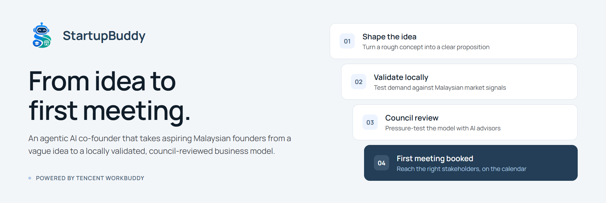
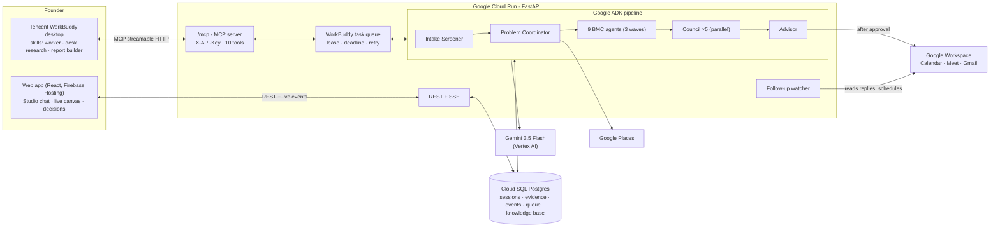
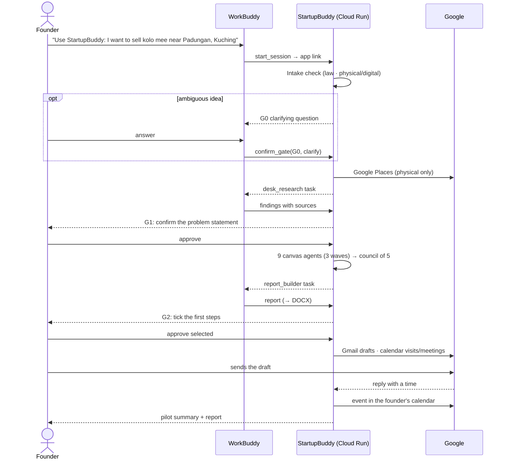

# StartupBuddy



**StartupBuddy** - An agentic AI solution that takes aspiring Malaysian founders from a vague business idea to a locally validated, council-reviewed business model and their first booked stakeholder meetings, powered by Tencent WorkBuddy.

**From idea to first meeting.**

| | |
|---|---|
| 🌐 **Try it** | https://dormathon-workspace-1.web.app (landing page → **Open demo app**) |
| 🔌 **API / MCP** | https://startupbuddy-api-960127792850.asia-southeast1.run.app (`/health`, `/mcp` for WorkBuddy) |
| 🏆 **Event** | Dormathon 2026 · Track 2: WorkBuddy Agentic Solutions |
| 👥 **Team** | SMILING FACE WITH SUNGLASSES: Nathan Yap (leader), Abraham Pang, Malcolm Sim, Zoe Tan |

> One sentence in → an intake check against Malaysian law → a problem statement grounded in your real neighbourhood → a 9-block Business Model Canvas → a 5-seat council review → first actions in your Google account, **only after you approve**.

---

## Contents
1. [The problem](#1-the-problem)
2. [The solution](#2-the-solution)
3. [Methodology: how the agents work](#3-methodology-how-the-agents-work)
4. [Architecture](#4-architecture)
5. [User flow](#5-user-flow)
6. [How to use it with Tencent WorkBuddy](#6-how-to-use-it-with-tencent-workbuddy)
7. [How to use the web app](#7-how-to-use-the-web-app)
8. [Impact](#8-impact)
9. [Feasibility and what is proven](#9-feasibility-and-what-is-proven)
10. [Commercial model](#10-commercial-model)
11. [Run locally and deploy](#11-run-locally-and-deploy)
12. [Repository structure](#12-repository-structure)
13. [Limitations and roadmap](#13-limitations-and-roadmap)

---

## 1. The problem

**Young Malaysians who want to start a business get stuck between "I have an idea" and "I'm talking to the right people about a validated plan".** They don't lack app builders or plan templates. They lack validation grounded in *their* neighbourhood and a concrete path to the right local people.

Take Aisyah *(an illustrative persona)*, a final-year student in Kuching who says *"I want to sell kolo mee near Padungan."* Today she:

1. **keeps the idea vague**: who buys, at what price, and why from her rather than the stalls already there?
2. **judges the market by gut feel**: no quick view of competitors within walking distance or their ratings;
3. **gets a generic plan from a chatbot** that would read the same for Kuala Lumpur or Jakarta;
4. **gets lost across scattered help**: SSM, the local council, food handler training, TEKUN, SME Corp, MYStartup;
5. **has nobody to challenge the plan**: no mentor saying "your price won't cover your rent";
6. **never takes the first step**: no meeting, no email, so the idea quietly dies.

| Evidence | Figure | Source | Strength |
|---|---|---|---|
| Micro-firms dominate Malaysian business | MSMEs = 96.2 % of establishments (1,292,580); micro = 77.4 % of MSMEs (2025) | [SME Corp / DOSM](https://smecorp.gov.my/index.php/en/policies/2020-02-11-08-01-24/profile-and-importance-to-the-economy) | Official |
| Few graduates become entrepreneurs | ≈ 1.4 % of public-university graduates self-employed (2010); 1.7 % (2013) vs a 5 % target | [UNIMAS IJBS](https://www.ijbs.unimas.my/repository/pdf/Vol15No1paper4.pdf); [HRMARS](https://hrmars.com/papers_submitted/6075/The_Relationship_between_Intention_and_Actual_Entrepreneurial_As_A_Career_Choice_of_Malaysian_Graduate.pdf) | Official tracer data, older |
| Young people don't know where to get help | Youths, especially rural, lack awareness of where to seek advice or financial aid (2023) | [Malay Mail, RYSE survey](https://www.malaymail.com/news/malaysia/2023/10/25/survey-malaysian-youths-limited-attraction-to-entrepreneurship-calls-for-greater-outreach-mentorship-programme/98321) | Survey, press report |
| Formal finance rarely reaches young founders | 6 % of youth entrepreneurs obtain financing from financial institutions (KRI, cited) | [IIUM repository](https://irep.iium.edu.my/81474/) | Secondary citation |
| Government help is a directory, not a doer | MYStartup Single Window aggregates resources and connections | [Vulcan Post](https://vulcanpost.com/859816/mystartup-single-window-startup-ecosystem-platform-malaysia) | Confirmed |

Full evidence ledger: [`docs/PROBLEM_STATEMENT.md`](docs/PROBLEM_STATEMENT.md). Competitor scan: [`docs/COMPETITORS.md`](docs/COMPETITORS.md).

---

## 2. The solution

**The problem isn't a lack of ideas. It's the gap to the first real step.** StartupBuddy closes that gap in one session:

| Step | What happens | Who does it |
|---|---|---|
| 🛡️ **Check** | The idea is screened against Malaysian law and classified as physical, digital or hybrid. Ambiguous wording ("sell drugs") triggers a clarifying question; illegal ideas are stopped with legal alternatives | Intake Screener |
| 🧭 **Ground** | For physical businesses, Google Maps finds real nearby competitors; for digital ones, online competitors are researched instead. Malaysian licences and programmes come from the knowledge base; WorkBuddy does web desk research | Problem Coordinator + WorkBuddy |
| 🧱 **Build** | Nine agents write the Business Model Canvas in three dependent waves (2 → 5 → 2) | 9 BMC agents |
| ⚖️ **Challenge** | A simulated Customer, CEO, Investor, CFO and Local Mentor score every block in parallel; plain code aggregates the verdict | 5-seat council |
| 🗓️ **Act** | The Advisor proposes first steps and picks the right kind for each: email draft, in-person visit, online meeting or task | Advisor |
| 📬 **Follow up** | When an organisation replies to an outreach email with a time, it goes into the founder's calendar (Meet link only if the reply says online, nobody invited) | Follow-up watcher |
| ✨ **Summarise** | A one-line pilot summary, a report (Markdown + DOCX) and a chat assistant grounded in the session | WorkBuddy + agents |

**What makes it different:** hyperlocal grounding, visible multi-agent collaboration, every figure labelled, guardrails enforced in code, and real actions that run only after approval. Generic AI plan generators and validators stop at a document. MYStartup is a directory.

---

## 3. Methodology: how the agents work

### 3.1 Pipeline (one goal, end to end)

| Phase | Agents | Tools | Checkpoint |
|---|---|---|---|
| 0 · Intake | `intake_screener` | Malaysian law knowledge in the prompt + code backstops | **G0** clarification (only if ambiguous; never auto-approved) |
| 1 · Ground | `problem_coordinator` | Google Places (physical/hybrid only), knowledge-base search, WorkBuddy `desk_research` | **G1** confirm or edit the problem statement |
| 2 · Build | 9 BMC agents in waves: ① customer segments, value propositions → ② channels, relationships, activities, resources, partners → ③ revenue streams, cost structure | knowledge-base search | |
| 3 · Challenge | 5 council seats in parallel + deterministic aggregation (mean per block; majority verdict) | | |
| 3b · Report | Tencent WorkBuddy `report_builder` | backend renders the DOCX | |
| 4 · Act | `advisor` | Google Workspace (Calendar, Meet, Gmail drafts) | **G2** approve each action (or Always allow) |
| 5 · Follow up | `follow_up` (reads replies) | Gmail read-only, Calendar | consent given at G2 ("then schedule when they reply") |

**16 agents** do the core work (1 coordinator + 9 BMC + 5 council + 1 advisor). Helper agents handle intake screening, reply reading, chat and the pilot summary. All run on **Gemini 3.5 Flash via Google ADK 2.6.1**, with structured outputs.

### 3.2 Guardrails and quality control, enforced in code

| Guardrail | How |
|---|---|
| Understand before planning | Intake screener verdicts `allowed / regulated / ambiguous / prohibited`; risky words ("drugs", "judi", "ah long"…) force a clarification even if the model says "allowed"; clearly illegal words block with the law cited (Dangerous Drugs Act 1952, Arms Act 1960…); deterministic fallback if the model stalls |
| Every figure labelled | `sourced` (needs a URL), `estimated` (needs a method) or `needs_verification`; unsupported labels are downgraded automatically and the database rejects violations |
| Nothing outward without approval | G1 and G2 checkpoints; Always allow is opt-in and logged; G0 is never auto-approved |
| Drafts, never sends | Gmail actions create drafts only; follow-up events go into the founder's own calendar with no attendees |
| Right action for the situation | email outreach first for people who haven't agreed to meet; site visits without video links; online meetings only when naturally online |
| Bounded and resilient | per-agent timeouts, one automatic retry per canvas block, WorkBuddy task leases and deadlines (max 2 attempts), visible fallbacks |
| Full audit trail | every thought summary, tool call, handoff and latency is stored and streamed live |

Details: [`docs/AGENTS.md`](docs/AGENTS.md), [`.claude/skills/startupbuddy-rules/SKILL.md`](.claude/skills/startupbuddy-rules/SKILL.md).

### 3.3 Where WorkBuddy fits

WorkBuddy connects to StartupBuddy as a **custom MCP connector**. Because MCP lets WorkBuddy call us but not the other way round, the cloud agents **enqueue tasks** and WorkBuddy's `startupbuddy-worker` skill **long-polls** them (`await_next_task`, ≤ 25 s per call, under WorkBuddy's ~30 s tool limit), does the work with its own skills, and posts structured JSON back (`submit_task_result`, schema-validated). WorkBuddy:

- **starts the run** from one prompt (`start_session`);
- **researches the market** on the web (`desk_research`: findings with sources and labels);
- **writes the full report** (`report_builder`; the backend turns it into a DOCX);
- **relays the founder's decisions** (`confirm_gate` for G0/G1/G2) and answers questions (`ask_session`, `check_followups`).

---

## 4. Architecture



| Layer | Technology |
|---|---|
| Frontend | React 18 + Vite + TypeScript, React Flow (canvas), anime.js (landing), Manrope / "Serene Executive Slate" design ([`docs/DESIGN.md`](docs/DESIGN.md)) |
| Backend | FastAPI, SQLAlchemy 2 async, Pydantic v2, MCP Python SDK 2.2 (streamable HTTP), python-docx |
| Agents | Google ADK 2.6.1, Gemini 3.5 Flash on Vertex AI (`global`), thinking level LOW with live thought summaries |
| Data | PostgreSQL 16 (Cloud SQL; Docker locally), full-text knowledge search |
| Integrations | Tencent WorkBuddy (custom MCP connector + skills), Google Places API (New), Google Calendar/Meet, Gmail (drafts + read-only reply tracking) |
| Hosting | Cloud Run (`asia-southeast1`), Firebase Hosting, Secret Manager |

Contracts: [`docs/MCP_CONTRACT.md`](docs/MCP_CONTRACT.md) · data model: [`docs/DATA_MODEL.md`](docs/DATA_MODEL.md) · system spec: [`docs/PROJECT_SPEC.md`](docs/PROJECT_SPEC.md).

---

## 5. User flow



---

## 6. How to use it with Tencent WorkBuddy

**Requirements:** WorkBuddy desktop (tested on 5.7.6) and the StartupBuddy MCP API key (Secret Manager `mcp-api-key`; ask the team).

1. **Add the MCP server.** In WorkBuddy, open **MCP Server Management → Add MCP** and paste the block below. The URL **must end in `/mcp`**. Then **Save**; you should see **startupbuddy** with all tools enabled.
   ```json
   {
     "mcpServers": {
       "startupbuddy": {
         "type": "http",
         "url": "https://startupbuddy-api-960127792850.asia-southeast1.run.app/mcp",
         "headers": { "X-API-Key": "<MCP_API_KEY>" }
       }
     }
   }
   ```
2. **Install the skills** (from this repo's root, PowerShell):
   ```powershell
   Copy-Item -Recurse -Force workbuddy\skills\startupbuddy-worker, workbuddy\skills\startupbuddy-desk-research, workbuddy\skills\startupbuddy-report-builder "$env:USERPROFILE\.workbuddy-ai\skills\"
   ```
3. **Start a new WorkBuddy task** (so the connector and skills load) and type one prompt:
   > Use StartupBuddy: I want to sell kolo mee near Padungan, Kuching.
4. **Watch and decide.** WorkBuddy shares the app link (open it to watch the canvas), runs its worker loop, and asks you at each checkpoint. You can also ask it things like *"Honestly, is this idea worth it?"* (`ask_session`) or *"Did JAIS reply?"* (`check_followups`).

**Good to know:** each empty poll costs WorkBuddy credits (≈ 1.4 per poll in our test), so the worker stops after 20 idle polls; a full run used ≈ 77 credits in our first test (before the report step was optimised). Troubleshooting: "SSE error 404" means the URL is missing `/mcp`; "unauthorized" means the key is wrong. More: [`docs/WORKBUDDY_INTEGRATION.md`](docs/WORKBUDDY_INTEGRATION.md).

---

## 7. How to use the web app

1. Open https://dormathon-workspace-1.web.app → **Open demo app** (single demo account, no login).
2. Type your idea and a Malaysian location → **Start agents**.
3. **Studio (left):** chat with StartupBuddy about your plan; watch each agent's thinking, tool calls and data sources live.
4. **Canvas (centre):** agent cards appear only when their step starts (skeleton → done); tap any card to inspect its content and labelled evidence; the pilot summary appears on top at the end.
5. **Decisions (right):** answer G0 if asked, approve G1 and G2 (or switch on **Always allow**), read the council scorecards, and track your first steps (**Check replies**, **Done**, **Reschedule**, **Retry**). Open the report or download the DOCX.

---

## 8. Impact

| Before | With StartupBuddy |
|---|---|
| Guesswork about the market | Real competitors near the location (e.g. 8 kolo mee stalls within 1 km of Padungan, Google Places) or real online competitors for digital ideas |
| Generic plans | A 9-block business model tied to the place, reviewed by 5 seats |
| Five agencies, no starting point | Licences and programmes identified up front by the intake check |
| Unverifiable numbers | Every figure labelled sourced, estimated or needs verification |
| No meeting booked | Email drafts, site visits and replies turned into calendar entries |
| Weeks of scattered searching | ≈ 4–5 minutes per full run in our tests (202 s and 277 s, both checkpoints auto-approved) |

**Pilot KPIs (planned):** time from intent to first meeting · % of report figures `sourced` · meetings actually held within 30 days · founder follow-through on `must_verify` items. Aligned with SDG 8 (decent work and economic growth).

---

## 9. Feasibility and what is proven

| Component | Status (2026-10-11) |
|---|---|
| Backend on Cloud Run + Cloud SQL, frontend on Firebase | ✅ Live |
| WorkBuddy MCP connector + long-poll task queue | ✅ EXP-1/EXP-2 passed (10 polls, 3 tasks) |
| Real WorkBuddy end-to-end run (one prompt → research → report → approvals) | ✅ Passed: desk research 11 findings (10 sourced) |
| Google Calendar events and Gmail drafts after approval | ✅ Executed on the demo account |
| Intake guardrails ("sell drugs" → clarify → blocked; pharmacist → regulated) | ✅ Tested locally |
| Digital vs physical (no Maps calls for a digital idea) | ✅ Tested locally |
| Reply tracking (Gmail read-only) | 🟠 Parser tested on sample replies; live tracking needs the read-only Gmail permission |
| Verified Malaysian knowledge base | 🟠 Small; being expanded |

Evidence log: [`docs/BUILD_LOG.md`](docs/BUILD_LOG.md) · experiments: `../sandbox/EXPERIMENTS.md` (workspace).

---

## 10. Commercial model

| | |
|---|---|
| **Users** | Students and first-time founders: **free** |
| **Payers (targets)** | Universities, incubators and state entrepreneurship programmes, per cohort licence |
| **Why they pay** | Founders arrive validated, with a reviewed plan and evidence |
| **Pricing method** | price per session ≈ (Gemini + cloud + WorkBuddy cost) × (1 + margin); cost per session to be measured in the pilot |
| **Ask** | A pilot with one Sarawak campus cohort |

No partner or customer is signed; all payers are targets.

---

## 11. Run locally and deploy

**Prerequisites:** Python 3.12 + [uv](https://docs.astral.sh/uv/), Node 20+, Docker, gcloud CLI (with Application Default Credentials for Vertex AI and Places), Firebase CLI.

```bash
docker compose up -d db                                      # Postgres on host port 5433
cd backend && cp .env.example .env                           # fill MCP_API_KEY etc. (names in docs/CREDENTIALS.md)
uv sync && uv run uvicorn app.main:app --port 8000           # API + /mcp
cd ../frontend && npm install && npm run dev                 # http://localhost:5173
```

Test without WorkBuddy: the team workspace has `sandbox/sim_worker.py` (not in this repo), a small MCP client that answers WorkBuddy's tasks with canned results.

**Deploy (Windows PowerShell, from this folder):**
```powershell
powershell -ExecutionPolicy Bypass -File infra\setup-cloud.ps1      # once: DB user, secrets, IAM
powershell -ExecutionPolicy Bypass -File infra\deploy-backend.ps1   # Cloud Run
powershell -ExecutionPolicy Bypass -File infra\deploy-frontend.ps1  # Firebase Hosting
```
Google Workspace (optional): create an OAuth client (Desktop app) as `backend/client_secret.json`, run `uv run python scripts/link_google.py`, then store `backend/token.json` as secret `gws-token` and redeploy. Secrets are never committed; names and locations only in [`docs/CREDENTIALS.md`](docs/CREDENTIALS.md).

---

## 12. Repository structure

```
startupbuddy/
├── backend/
│   ├── app/agent/        # pipeline, prompts, agent factories, assistant, follow-up watcher
│   ├── app/mcp/          # WorkBuddy MCP server (/mcp), Google Workspace actions
│   ├── app/workbuddy/    # task queue, output schemas, DOCX rendering
│   ├── app/routers/      # REST + SSE API
│   ├── app/models/       # SQLAlchemy models (+ idempotent migrations)
│   ├── app/rag/  app/tools/   # knowledge search, Google Places
│   └── scripts/link_google.py
├── frontend/             # React app: landing (/), sessions (/app), workspace (/app/s/:id), report
├── workbuddy/skills/     # WorkBuddy skills: worker, desk research, report builder
├── knowledge/            # verified knowledge-base documents (front matter with source_url)
├── docs/                 # spec, agents, MCP contract, data model, evidence, build log, design
├── infra/                # setup + deploy scripts (PowerShell)
├── Dockerfile  docker-compose.yml  firebase.json
└── CLAUDE.md  PLAN.md  MASTER_SHEET.md
```

---

## 13. Limitations and roadmap

- **Knowledge base:** only a few verified documents so far; next: SSM, DBKU/MBKS licensing, food handler training, TEKUN, SME Corp, MYStartup, halal, OpenDOSM district data.
- **Vector search:** retrieval is full-text today; embeddings (EmbeddingGemma or Vertex) are next for true hybrid search.
- **Council revision loop:** weak blocks are flagged; automatic re-writing (≤ 2 rounds) is designed but not yet switched on.
- **WorkBuddy depth:** WorkBuddy starts runs, researches, writes the report and relays decisions; the 16 agents run on Cloud Run. Next: let WorkBuddy execute approved Google actions through its own connectors.
- **Guidance, not legal advice:** the intake check flags laws and licences; founders should confirm with the regulator.
- **Demo scope:** single demo account, no user registration.

---

*Built for Dormathon 2026 by team SMILING FACE WITH SUNGLASSES. Design: [`docs/DESIGN.md`](docs/DESIGN.md) · Brand: [`docs/brand/`](docs/brand/).*
